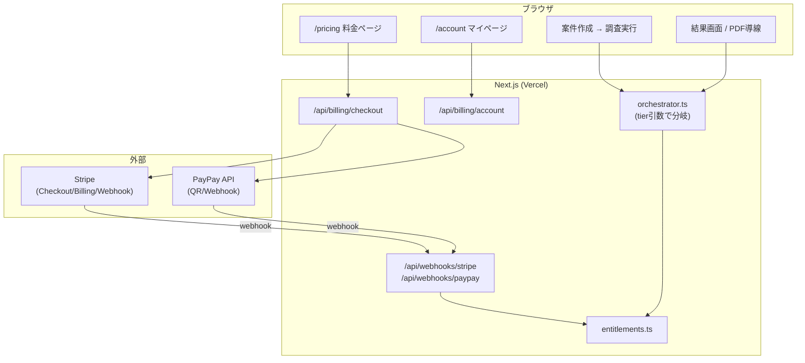
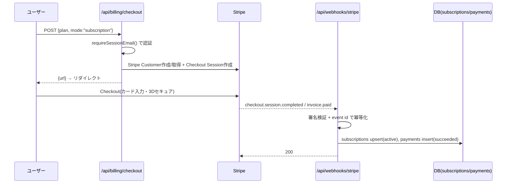
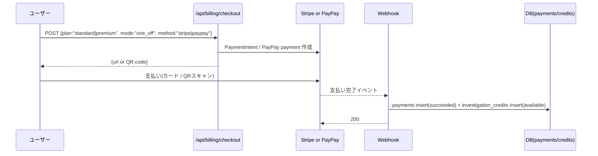
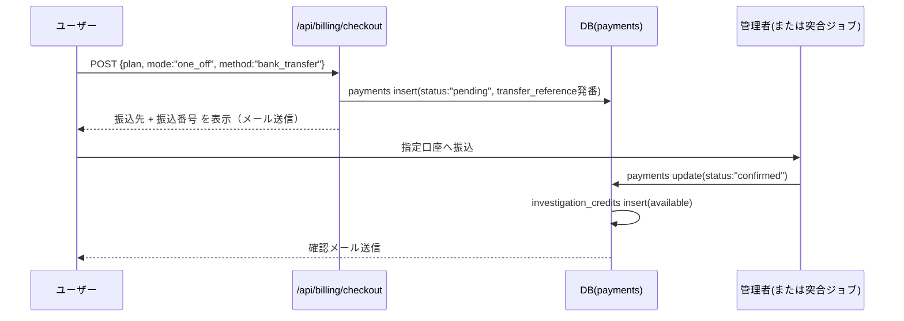
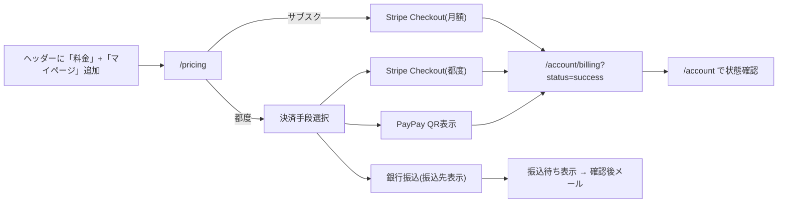

# 決済機能 設計書（Payment Architecture）

**本文書の目的**: Export Risk Navi に「無料 / スタンダード / プレミアム」の3段階料金プランと、クレジットカード（Stripe）・PayPay・銀行振込の3決済手段を導入するための設計を、実装前に確定させること。

**対象外（本設計のスコープ外）**:
- 領収書・インボイス（適格請求書）対応の法務設計（実装フェーズで別途検討）
- 法人・チーム契約（`docs/account-migration.md` の法人アカウント移行とは独立）
- 返金処理の自動化（手動返金のみ許容する方針）

**前提（コードベース調査に基づく）**:
- 認証はOTPメール認証。セッションは `SESSION_COOKIE_NAME`（既定 `ern_session_email`）に「メール + HMAC署名」を載せたCookieであり、**ユーザー識別の主キーはメールアドレス**（`src/lib/auth/server.ts` の `getSessionEmail()`）。
- 既存テーブルはメールを外部キー的に使う（`cases.userEmail`, `aiConsultations.userEmail`, `auditLogs.actorEmail`）。**`users` テーブルは定義はあるが認証フローではINSERTされていない**。よって請求系もメールをキーにする（後述）。
- 調査は `src/lib/investigation/orchestrator.ts` の `runInvestigation()` が3プロバイダー（GPT-4o / Claude / Gemini）を並列実行し、`buildAiProviders()` が `getEnabledAiModels()` の順序でプロバイダーを生成する。
- 高度な演算（後述の「高度な演算」）は既に orchestrator 内に実装済み: `crossReview` / `integratedEvaluation` / `reviewMeeting` / `agreementRate` / `improvementSteps` / `worstCaseScenarios`。
- PDF出力は `GET /api/reports/[caseId]/pdf`（`src/app/api/reports/[caseId]/pdf/route.tsx`）が `@react-pdf/renderer` で生成。
- 非同期ジョブ入口として `src/app/api/webhooks/inngest/route.ts` がプレースホルダとして予約済み（現状は同期実行のみ）。
- DBはDrizzle ORM + Neon Postgres。マイグレーションは `drizzle/` 配下、ジャーナルの次は idx=4（`0004_*.sql`）。

---

## 目次

1. [プラン定義と権利（Entitlements）](#1-プラン定義と権利entitlements)
2. [決済アーキテクチャ](#2-決済アーキテクチャ)
3. [DBスキーマ設計（Drizzle ORM）](#3-dbスキーマ設計drizzle-orm)
4. [機能ゲーティング設計](#4-機能ゲーティング設計)
5. [UI導線設計](#5-ui導線設計)
6. [Webhook / 非同期処理](#6-webhook--非同期処理)
7. [既存フローとの統合（OTP認証・調査フロー）](#7-既存フローとの統合otp認証調査フロー)
8. [実装フェーズ分け（ロードマップ）](#8-実装フェーズ分けロードマップ)
9. [環境変数](#9-環境変数)
10. [リスクと注意点](#10-リスクと注意点)

---

## 1. プラン定義と権利（Entitlements）

料金と機能は以下のとおり（**確定仕様**）。

| プラン | 月額（サブスク） | 都度（1回のフル調査） | 調査方式 | 出力 | 高度な演算 | PDF |
|---|---|---|---|---|---|---|
| 無料 | — | — | **1モデル固定**（簡易調査） | **基本結果画面のみ**（簡易出力） | なし | なし |
| スタンダード | 3,000円/月（調査無制限） | 1,000円/回 | **3モデル統合調査**（フル調査） | フル結果画面 | なし | なし |
| プレミアム | 6,000円/月（調査無制限） | 2,000円/回 | **3モデル統合調査**（フル調査） | フル結果画面 | **あり** | **あり** |

**用語の定義（既存実装への対応付け）**:

- **簡易調査（無料）**: `buildAiProviders()` が生成するプロバイダーを **1件（固定: GPT-4o）** に限定して実行する。集約処理（`aggregateFindings`）は動くが、マルチモデル依存の出力は生成しない。
- **フル調査（スタンダード/プレミアム共通）**: 3プロバイダー並列実行 + `aggregateFindings`（次元ごと最悪ケース集約）+ モデル別比較（`buildModelResults`）+ 一致率（`calcAgreementRate`）+ 不一致次元（`findDisagreementDimensions`）+ ナラティブ生成。**PDFは出さない。**
- **高度な演算（プレミアムのみ）**: 以下は既存 orchestrator に実装済みのマルチモデル・コンセンサス系フィールド。プレミアムでのみ生成し、それ以外は `null` / 空配列にする。
  - `crossReview`（多数決 / 重み付けコンセンサス）
  - `integratedEvaluation`（「3つのAIによる統合評価」一致点・不一致点）
  - `reviewMeeting`（AI議論タイムライン）
  - `improvementSteps`（改善シミュレーション）
  - `worstCaseScenarios`（最悪ケースシナリオ）
- **簡易出力（無料）**: 結果画面は `summary`（グレード）・`dimensions`（次元別スコア）・`evidence`・`reportNarrative` の基本セクションのみ。モデル別比較・統合評価・PDF導線を表示しない。

**権利（Entitlements）のモデル**（`src/lib/billing/entitlements.ts` を新設、設計上の型）:

```ts
type PlanTier = "free" | "standard" | "premium";

type Entitlements = {
  tier: PlanTier;
  aiModels: AiModel[];          // free: ["gpt-4o"]、standard/premium: 3モデル
  fullIntegration: boolean;     // 3モデル統合調査を実行するか
  advancedCompute: boolean;     // 高度な演算（コンセンサス系）を生成するか
  canExportPdf: boolean;        // PDF出力可否
  monthlyUnlimited: boolean;    // 有効なサブスクがあるか
  remainingCredits: number;     // 未消費の都度クレジット数
};
```

プラン定義はコード内カタログ（`src/lib/billing/plans.ts`）に置き、DBには「ユーザーがどのプラン/状態か」のみを保存する（`constants.ts` の `RISK_DIMENSIONS` と同じ、コード定数方式）。3プラン固定のためDBテーブル化しない。

---

## 2. 決済アーキテクチャ

### 2.1 決済手段ごとの役割分担

| 決済手段 | サブスク（月額） | 都度課金 | 備考 |
|---|---|---|---|
| Stripe（クレカ） | 対応（Checkout `mode=subscription`） | 対応（Checkout `mode=payment`） | メイン。サブスク更新・カード管理は Billing Portal |
| PayPay | 非対応（PayPay API は定期課金非対応） | 対応（QR決済） | 都度のみ。ペイペイ加盟店（ビジネス/ウォレット）契約が前提 |
| 銀行振込 | 非対応 | 対応（手動確認） | 都度のみ。Webhookなし、管理者/自動突合で確認 |

**設計判断**: サブスクリプション（継続課金）は **Stripeに一本化**する。PayPay・銀行振込は「都度課金（フル調査1回分のクレジット購入）」専用とする。これはPayPay API に定期課金の仕組みがなく、銀行振込に自動更新の概念がないため。サブスクをPayPay/振込でも受けたい場合の将来拡張は「都度クレジットのまとめ買い」で代替可能。

### 2.2 構成図



### 2.3 APIフロー

**A. サブスク購入（Stripe）**



**B. 都度課金（Stripe / PayPay）**



**C. 銀行振込（都度）**



---

## 3. DBスキーマ設計（Drizzle ORM）

既存 `src/lib/db/schema.ts` の流儀（`pgTable` / `varchar` 主キー / `jsonb` / `timestamp withTimezone` / `index()` 第三引数）に合わせる。**新規4テーブル**。マイグレーションは `drizzle-kit generate` で `0004_*.sql` として生成する想定。

```ts
// src/lib/db/schema.ts に追記（設計。boolean は drizzle-orm/pg-core から追加 import）
import {
  boolean,          // ← 追加
  index, integer, jsonb, pgTable, text, timestamp, varchar,
} from "drizzle-orm/pg-core";

/**
 * Stripe Customer との対応。メールを主キーにすることで、
 * 既存の「メール中心」の認証・案件モデルと整合させる（users.id への依存を避ける）。
 */
export const billingCustomers = pgTable(
  "billing_customers",
  {
    userEmail: varchar("user_email", { length: 255 }).primaryKey(),
    stripeCustomerId: varchar("stripe_customer_id", { length: 128 }).unique(),
    createdAt: timestamp("created_at", { withTimezone: true }).notNull(),
    updatedAt: timestamp("updated_at", { withTimezone: true }).notNull(),
  },
);

/**
 * サブスク状態。1ユーザー = 1行（user_email ユニーク）。
 * Stripe を正（source of truth）とし、webhook で同期する。
 */
export const subscriptions = pgTable(
  "subscriptions",
  {
    id: varchar("id", { length: 64 }).primaryKey(),
    userEmail: varchar("user_email", { length: 255 }).notNull().unique(),
    plan: varchar("plan", { length: 32 }).notNull(), // "standard" | "premium"
    status: varchar("status", { length: 32 }).notNull(), // active | past_due | canceled | incomplete
    stripeCustomerId: varchar("stripe_customer_id", { length: 128 }),
    stripeSubscriptionId: varchar("stripe_subscription_id", { length: 128 }).unique(),
    currentPeriodStart: timestamp("current_period_start", { withTimezone: true }),
    currentPeriodEnd: timestamp("current_period_end", { withTimezone: true }),
    cancelAtPeriodEnd: boolean("cancel_at_period_end").notNull().default(false),
    createdAt: timestamp("created_at", { withTimezone: true }).notNull(),
    updatedAt: timestamp("updated_at", { withTimezone: true }).notNull(),
  },
  (table) => [index("subscriptions_user_email_idx").on(table.userEmail)],
);

/**
 * 決済履歴（全方式共通の台帳）。サブスク請求・都度課金の両方を記録し、
 * マイページの履歴表示と監査に使う。provider_event_id で冪等化する。
 */
export const payments = pgTable(
  "payments",
  {
    id: varchar("id", { length: 64 }).primaryKey(),
    userEmail: varchar("user_email", { length: 255 }).notNull(),
    amount: integer("amount").notNull(), // 円（JPY）。小数を使わないため integer
    currency: varchar("currency", { length: 8 }).notNull().default("JPY"),
    method: varchar("method", { length: 32 }).notNull(), // "stripe" | "paypay" | "bank_transfer"
    kind: varchar("kind", { length: 32 }).notNull(), // "subscription" | "one_off"
    plan: varchar("plan", { length: 32 }), // one_off の場合は standard | premium。subscription の場合は null可
    status: varchar("status", { length: 32 }).notNull(), // pending | succeeded | failed | refunded | canceled
    providerReference: varchar("provider_reference", { length: 128 }), // Stripe PaymentIntent/Subscription ID、PayPay paymentId
    providerEventId: varchar("provider_event_id", { length: 128 }), // webhook event id（冪等キー）
    providerPayload: jsonb("provider_payload"), // 生webhook（監査用、必要最小限）
    transferReference: varchar("transfer_reference", { length: 64 }), // 銀行振込の振込番号
    confirmedAt: timestamp("confirmed_at", { withTimezone: true }),
    createdAt: timestamp("created_at", { withTimezone: true }).notNull(),
    updatedAt: timestamp("updated_at", { withTimezone: true }).notNull(),
  },
  (table) => [
    index("payments_user_email_idx").on(table.userEmail),
    index("payments_provider_reference_idx").on(table.providerReference),
    index("payments_status_idx").on(table.status),
  ],
);

/**
 * 都度課金クレジット。「1回のフル調査」を1クレジットとして購入・消費する。
 * サブスク契約中は monthlyUnlimited が優先され、本テーブルは消費しない。
 */
export const investigationCredits = pgTable(
  "investigation_credits",
  {
    id: varchar("id", { length: 64 }).primaryKey(),
    userEmail: varchar("user_email", { length: 255 }).notNull(),
    paymentId: varchar("payment_id", { length: 64 }).notNull(), // payments.id 参照
    plan: varchar("plan", { length: 32 }).notNull(), // "standard" | "premium"
    amount: integer("amount").notNull(), // 購入額（円）
    status: varchar("status", { length: 32 }).notNull(), // available | consumed | expired | refunded
    consumedCaseId: varchar("consumed_case_id", { length: 64 }), // 消費時に紐づく案件
    createdAt: timestamp("created_at", { withTimezone: true }).notNull(),
    consumedAt: timestamp("consumed_at", { withTimezone: true }),
  },
  (table) => [
    index("investigation_credits_user_email_idx").on(table.userEmail),
    index("investigation_credits_status_idx").on(table.status),
  ],
);
```

**設計判断**:
- **金額は `integer`（円）**。浮動小数の誤差を避ける。表示時に `¥3,000` 等へ整形する（既存 `formatDate` 等の `src/lib/utils.ts` に金額整形を追加）。
- **メールをキーにする**。既存コードは `users.id` を一切使っていない（`cases.userEmail` 等で直参照）。`users` テーブルへのINSERTを認証に追加する大掛かりな変更を避け、リスクを最小化する。
- **クレジットは「消費型の台帳」**。残高を1つのカウンタで持たず、行の状態遷移（available → consumed）で管理する。これにより「どの案件に消費したか」（`consumedCaseId`）まで追跡でき、監査・返金に耐える。
- **冪等性**: `payments.providerEventId` をユニーク制約にはしないが、挿入前に既存行を検索して重複を弾く（webhook再送対策）。必要なら `(provider_event_id)` にユニークインデックスを貼る（フェーズ2で確定）。

---

## 4. 機能ゲーティング設計

### 4.1 単一の権限解決点

サーバー側の正は **`src/lib/billing/entitlements.ts` の `resolveEntitlements(userEmail): Promise<Entitlements>`** に一本化する。判定ロジック:

```
resolveEntitlements(email):
  1. subscriptions に active かつ currentPeriodEnd > now の行があれば
     → tier = その行の plan、monthlyUnlimited = true
  2. なければ investigation_credits の available 残数を数える
     → 残 > 0 なら tier = クレジットの plan、monthlyUnlimited = false、remainingCredits = 残数
  3. どちらも無ければ tier = "free"
```

tier から `aiModels` / `fullIntegration` / `advancedCompute` / `canExportPdf` を導出する（プランカタログ参照）。

### 4.2 チェックポイント（どこでゲートするか）

| ゲート点 | 現在の実装 | 変更内容 |
|---|---|---|
| `POST /api/cases`（案件作成） | `getSessionEmail()` のみ | **変更不要**。無料ユーザーも簡易調査のため案件作成を許可。tier は実行時に解決 |
| `POST /api/investigations/[id]/run`（調査実行） | `runInvestigation(id, email)` | `resolveEntitlements` を呼び、`tier` を orchestrator に渡す。tier に応じてモデル数・高度演算を分岐。**free は1モデル、standard/premium は3モデル**。都度課金（サブスク無し・クレジット有り）の場合、調査開始時に1クレジットを原子的に消費（`available → consumed` へのCAS的UPDATE） |
| `GET /api/reports/[caseId]/pdf`（PDF） | `getSessionEmail()` + `assertCaseOwner` | `canExportPdf` を追加チェック。非プレミアムは `402 Payment Required`（または403 + アップグレード誘導メタデータ）を返す |
| 結果画面（クライアント） | 全フィールド表示 | `assessment` に `tier`（または `advancedCompute` フラグ）を含め、プレミアム以外は高度演算セクションとPDFボタンを非表示。**サーバー側ゲートが正で、クライアントは表示制御のみ** |

### 4.3 orchestrator への tier 引数の導入

`runInvestigation(caseId, userEmail, tier)` とし、内部を分岐する。

- **モデル選択**: `buildAiProviders()` → `buildAiProviders(tier)` に変更。
  - `free`: `getEnabledAiModels()` の先頭1件（既定 GPT-4o）のみ。1件でも `aggregateFindings` は正常動作する（`calcAgreementRate` は件数<2で100を返す既存実装あり）。
  - `standard` / `premium`: 従来どおり3プロバイダー。
- **高度演算の生成分岐**: `tier === "premium"` の場合のみ `crossReview` / `integratedEvaluation` / `reviewMeeting` / `improvementSteps` / `worstCaseScenarios` を計算し、それ以外は `undefined`（AssessmentRecord はこれらを既に optional で保持している。`src/lib/types.ts` の `AssessmentRecord` を確認済み）。
- **保存**: `saveAssessment()` に tier を保存するため、`risk_assessments` に `tier` 列を追加する（下記マイグレーション）。

**`risk_assessments` への追記（ゲーティング結果の永続化）**:

```ts
// riskAssessments に追加
tier: varchar("tier", { length: 32 }), // "free" | "standard" | "premium"（実行時の権限スナップショット）
```

実行時の tier をスナップショット保存することで、後からサブスクが切れても「その調査が当時どの権限で作られたか」が分かり、PDF再生成の可否判定（プレミアム当時に作られた案件のPDF再出力など）にも使える。既存レコードは `null` のため、`null` は「プレミアム相当（旧仕様）」とみなすか、フェーズ1で「legacy」を補完する（§8参照）。

### 4.4 ゲーティング行列（確定）

| 機能 | 無料 | スタンダード | プレミアム |
|---|---|---|---|
| 案件作成 | ○ | ○ | ○ |
| 調査実行 | ○（1モデル固定） | ○（3モデル） | ○（3モデル） |
| モデル別比較・一致率 | × | ○ | ○ |
| 高度な演算（コンセンサス等） | × | × | ○ |
| PDF出力 | × | × | ○ |
| サブスク（月額・無制限） | — | 3,000円 | 6,000円 |
| 都度（1回） | — | 1,000円 | 2,000円 |

---

## 5. UI導線設計

### 5.1 ページ構成（新規）

| ページ | パス | 用途 |
|---|---|---|
| 料金ページ | `/pricing` | 3プラン比較、サブスク/都度の選択、各決済手段の入口 |
| マイページ | `/account` | プラン管理・決済履歴・クレジット残・サブスク解約 |
| （決済状態） | `/account/billing?status=...` | チェックアウト後のリダイレクト先（成功/キャンセル表示） |

### 5.2 導線フロー



### 5.3 既存ヘッダーへの組み込み

`src/components/layout/header.tsx` の `navItems`（現在: メイン/デモ/辞典/AI相談室/学習/概要）に「料金」を追加し、ログイン状態に応じて「マイページ」リンクを表示する。現在ヘッダーは認証状態を表示していないため、`getSessionEmail()` 相当をサーバーから渡すか、クライアントで `/api/billing/account` を叩いて表示を切り替える（フェーズ2）。

### 5.4 マイページ（`/account`）の内容

- 現在のプラン（無料/スタンダード/プレミアム）とステータス
- サブスク: 次回更新日、解約（Stripe Billing Portal へ）、プラン変更（スタンダード⇔プレミアム）
- 都度クレジット: 残数、購入導線
- 決済履歴: `payments` テーブルの一覧（日時・種別・金額・方法・状態）
- 銀行振込: 振込待ち（pending）の表示と振込先・振込番号

### 5.5 アップグレード誘導（ペイウォール）

- 調査実行時に都度クレジットが無くサブスクも無いユーザーがフル調査を要求した場合 → フリー（1モデル簡易調査）で続行するか、アップグレードを促す画面（`/pricing?plan=standard&mode=one_off`）へ導線。
- PDFボタンはプレミアム以外で「プレミアム限定」表示にし、クリックで `/pricing?plan=premium` へ。

---

## 6. Webhook / 非同期処理

### 6.1 Stripe Webhook

- エンドポイント: `POST /api/webhooks/stripe`（Route Handler）。
- `stripe` ライブラリの `constructEventAsync`（または `constructEvent`）で署名検証。`STRIPE_WEBHOOK_SECRET` 必須（未設定時は fail-closed で 400）。
- 処理対象イベントと対応:
  | イベント | 処理 |
  |---|---|
  | `checkout.session.completed` | `mode=subscription` → `subscriptions` upsert(active) + `payments` insert。`mode=payment` → `payments` insert(succeeded) + `investigation_credits` insert |
  | `invoice.paid` | サブスク継続更新 → `subscriptions.currentPeriodEnd` 更新（`payments` に請求記録） |
  | `invoice.payment_failed` | `subscriptions.status="past_due"` + 未払いメール（dunning） |
  | `customer.subscription.updated` | `cancelAtPeriodEnd` / プラン変更を同期 |
  | `customer.subscription.deleted` | `subscriptions.status="canceled"`（期間終了で無料へ） |

- **冪等性**: 各イベントの `event.id` を `payments.providerEventId` に保存し、処理前に既存チェック。`200` を素早く返し、DB書き込みは `withDbErrorHandling`（既存 `src/lib/db/errors.ts`）で包む。失敗時は Stripe が自動リトライする。

### 6.2 PayPay Webhook

- エンドポイント: `POST /api/webhooks/paypay`。
- PayPay API v2 の署名検証ヘッダー（`x-paypay-authorization` 等）を検証。`PAYPAY_WEBHOOK_SECRET` を使用。
- 処理対象: 支払い完了（`payment.captured` / 完了通知）→ `payments` insert(succeeded) + `investigation_credits` insert(available) + メール送信。
- PayPay は **加盟店審査・APIキー発行が前提**。審査前はモック/手動確認で開発を進める（フェーズ3）。

### 6.3 銀行振込（Webhookなし・突合確認）

- 振込依頼時に `payments` を `status="pending"`、`transferReference`（振込番号）を発番し、振込先と番号を画面表示 + メール送信。
- **確認フロー（2案から選択、推奨はB）**:
  - **案A（手動）**: 管理者が口座明細を確認し、管理画面で `pending → confirmed` に変更。その後クレジット付与 + 確認メール。
  - **案B（半自動・推奨）**: 銀行のCSV明細（または法人インターネットバンキングのAPI）を取り込み、`transferReference` で突合して `confirmed` に更新。マッチしないものは管理者確認に回す。Vercel Cron（`vercel.json` の `crons`）または既存 `src/app/api/webhooks/inngest/route.ts` の将来拡張で定期実行。
- 入金確認前はクレジットを付与しない（`investigation_credits` は `confirmed` 時に初めて `available` として挿入）。

### 6.4 非同期の扱い

- Webhook ハンドラは「検証 → 冪等DB書き込み → 200」を同期で行う（Vercelの60秒上限内で十分収まる書き込みのみ）。
- メール送信などの遅延しても良い処理は、既存の同期パス（`src/lib/mail/sender.ts`）を使いつつ、失敗しても決済状態に影響しないよう try/catch で分離（Sentry に記録）。
- 定期処理（銀行振込突合、サブスク期限切れの棚卸し）は Vercel Cron で実装。既存 `inngest` プレースホルダは、ジョブ量が増えた場合の移行先として位置付ける。

---

## 7. 既存フローとの統合（OTP認証・調査フロー）

### 7.1 認証との統合（OTPメール認証）

- 決済系APIはすべて `getSessionEmail()` / `requireSessionEmail()`（`src/lib/auth/server.ts`）で認証する。**OTPフロー自体は変更しない**。
- メールキー方式のため、既存セッションCookieの値をそのまま請求の主体識別子として使える。追加のユーザーマイグレーションは不要。
- `ADMIN_EMAILS`（管理者）には、銀行振込の手動確認・返金を行う管理画面（`/admin/billing` 新設）へのアクセスを付与する。

### 7.2 調査フローを壊さないための原則

- **案件作成（`POST /api/cases`）は変更しない**。無料でも案件作成→簡易調査は可能。
- **調査実行（`POST /api/investigations/[id]/run`）のデフォルト挙動を変えない**ための移行措置（§8フェーズ1参照）。既存ユーザーは一時的に `standard`（3モデル・フル出力・PDFなし）として扱うか、`ADMIN_EMAILS` と既存案件保有者に限り一時的にプレミアム相当を付与する。
- **レート制限（`checkAiRateLimit`）はそのまま**。free は1モデルのため3モデル時よりコストが低く、既存の上限値で問題ない。standard/premium の無制限サブスクユーザーに対する日次上限の緩和は、コスト暴走ガードを維持する観点から**原則緩和しない**（制限は継続しつつ、上限値の見直しは運用フェーズで判断）。
- **タイムアウト**: free（1モデル）は既存 `INVESTIGATION_TOTAL_TIMEOUT_MS`（55秒）より速く終わるため、`maxDuration=60` の制約内に収まる。変更不要。

### 7.3 追加する API ルート（設計）

| ルート | 認証 | 役割 |
|---|---|---|
| `POST /api/billing/checkout` | セッション必須 | サブスク/都度のCheckout作成、PayPay QR作成、銀行振込依頼 |
| `GET /api/billing/account` | セッション必須 | マイページ用: 権限・サブスク・履歴・クレジット残 |
| `POST /api/billing/portal` | セッション必須 | Stripe Billing Portal セッションURL発行 |
| `POST /api/webhooks/stripe` | 署名検証 | Stripeイベント処理 |
| `POST /api/webhooks/paypay` | 署名検証 | PayPayイベント処理 |
| `GET /api/admin/billing` / `POST /api/admin/billing/confirm` | 管理者 | 銀行振込確認・返金（管理者） |

---

## 8. 実装フェーズ分け（ロードマップ）

**前提**: 各フェーズ完了時点で既存の調査フローが壊れていないこと、`typecheck` と `test:unit` が通ることをゲートとする。

### フェーズ0: 準備（依存なし）
- Stripe / PayPay のアカウント・APIキー・Webhook エンドポイント・価格（Price）の登録方針を確定。
- 銀行振込の振込先・振込番号の採番ルールを確定。
- 本設計の法務確認（特定商取引法に基づく表記、決済手段の明示）。

### フェーズ1: 基盤（外部決済なし・ゲーティング先行）
- DBマイグレーション: `billing_customers` / `subscriptions` / `payments` / `investigation_credits` の4テーブル + `risk_assessments.tier` 追加。
- `src/lib/billing/plans.ts`（プランカタログ）と `src/lib/billing/entitlements.ts`（権限解決）を実装。
- orchestrator に `tier` 引数を導入し、free=1モデル / 有料=3モデル / プレミアム=高度演算 の分岐を実装。PDFルートに `canExportPdf` ゲートを追加。
- **移行措置**: 既存ユーザーの挙動を変えないため、ロールアウト初期は `DEFAULT_PLAN_TIER`（既定 `"standard"`）を導入するか、既存案件保有者に一時プレミアムを付与する。権限解決で行が見つからない場合のフォールバックを `"free"` にした上で、切り替えタイミングをビジネス側で決定する（**要確認事項**）。

### フェーズ2: Stripe（サブスク + 都度）
- `billing_customers` / `subscriptions` のStripe連携、Checkout（`mode=subscription` / `mode=payment`）、Billing Portal。
- `POST /api/billing/checkout` / `GET /api/billing/account` / `POST /api/billing/portal`。
- `/pricing` と `/account` の基本UI、ヘッダーへの「料金」「マイページ」追加。
- Stripe Webhook（`checkout.session.completed` / `invoice.paid` / `invoice.payment_failed` / `customer.subscription.*`）。

### フェーズ3: PayPay + 銀行振込（都度）
- PayPay QR決済（都度）+ PayPay Webhook。加盟店審査待ちの間はモックで検証。
- 銀行振込（振込先・振込番号・pending管理）+ 管理者確認画面（`/admin/billing`）+ 確認メール。
- 都度クレジットの消費ロジック（調査開始時の原子的消費）を本格稼働。

### フェーズ4: 運用・監視・堅牢化
- 銀行振込の自動突合（Vercel Cron / 将来はInngest）。
- 決済イベントの Sentry 監視、アラート（webhook失敗・未払い・突合漏れ）。
- 領収書・インボイス対応、返金フロー、dunning（未払い催促）の整備。
- レート制限・タイムアウトの実測値に基づく再調整。

---

## 9. 環境変数

既存 `.env.example` に追記する設計（本番は `env.production.example` にも反映）。

```bash
# Stripe
STRIPE_SECRET_KEY=
STRIPE_WEBHOOK_SECRET=
STRIPE_PRICE_STANDARD_MONTHLY=     # 3,000円/月 の Price ID
STRIPE_PRICE_PREMIUM_MONTHLY=      # 6,000円/月 の Price ID
STRIPE_PRICE_STANDARD_ONE_OFF=     # 1,000円/回 の Price ID
STRIPE_PRICE_PREMIUM_ONE_OFF=      # 2,000円/回 の Price ID

# PayPay
PAYPAY_API_KEY=
PAYPAY_API_SECRET=
PAYPAY_MERCHANT_ID=
PAYPAY_WEBHOOK_SECRET=
PAYPAY_ENV=sandbox                  # sandbox | production

# 銀行振込
BANK_TRANSFER_ACCOUNT_NAME=
BANK_TRANSFER_ACCOUNT_NUMBER=
BANK_TRANSFER_BRANCH=
BANK_TRANSFER_BANK_NAME=

# ロールアウト移行用（フェーズ1）
DEFAULT_PLAN_TIER=free              # 移行期間中の既定プラン（§8参照）
```

---

## 10. リスクと注意点

1. **既存ユーザーのダウングレード**: 現状は全ユーザーが実質3モデル+PDFを使えている。ゲート導入で既存ユーザーが突然「無料（1モデル・PDFなし）」に落ちるのはビジネス上の影響が大きい。→ 移行措置（`DEFAULT_PLAN_TIER` または一時プレミアム付与）を必ず用意し、切り替えタイミングを明示すること。
2. **サーバー側ゲートの徹底**: クライアントの非表示だけでは不十分。`/api/reports/[caseId]/pdf` と orchestrator の権限解決は必ずサーバーで行う（クライアント改変によるPDF取得や高度演算の無断実行を防ぐ）。
3. **冪等性と二重付与**: Webhook の再送でクレジットを二重付与しないよう、`providerEventId` で必ず冪等化する。銀行振込は `transferReference` の重複突合にも注意。
4. **PayPay の加盟店審査**: PayPay API 利用には審査が必要。審査完了まで本番のPayPay決済は開始できないため、フェーズ3はモック先行。
5. **JPYとStripeの通貨**: Priceは `jpy` で作成。Stripeの`jpy`は小数なし（`unit_amount` が円）で、`payments.amount`（integer円）と一致させる。
6. **タイムアウト制約**: 調査実行は `maxDuration=60` のため、決済処理を調査実行リクエスト内に混ぜない。決済は専用ルート+webhookで分離する。
7. **コスト暴走**: 無制限サブスクでも `checkAiRateLimit` の日次上限は維持する（§7.2）。上限値の緩和は実測後に判断。

---

## 付録: 要確認事項（マネージャー判断）

- 既存ユーザーをどの tier でロールアウトするか（`free` に落とす / 一定期間 `standard` を付与 / 既存案件保有者は `premium` を付与）。
- 銀行振込の確認を手動（案A）で始めるか、突合自動化（案B）を初期から組み込むか。
- スタンダードの「フル調査」に「モデル別比較・一致率」を含めるか（本設計では「含む」と定義）。含めない場合は standard の結果画面を free とほぼ同水準にし、standard の価値を3モデル統合の「精度」に置くことになる。
- 領収書・インボイス対応の要否と、適格請求書事業者登録の有無。
